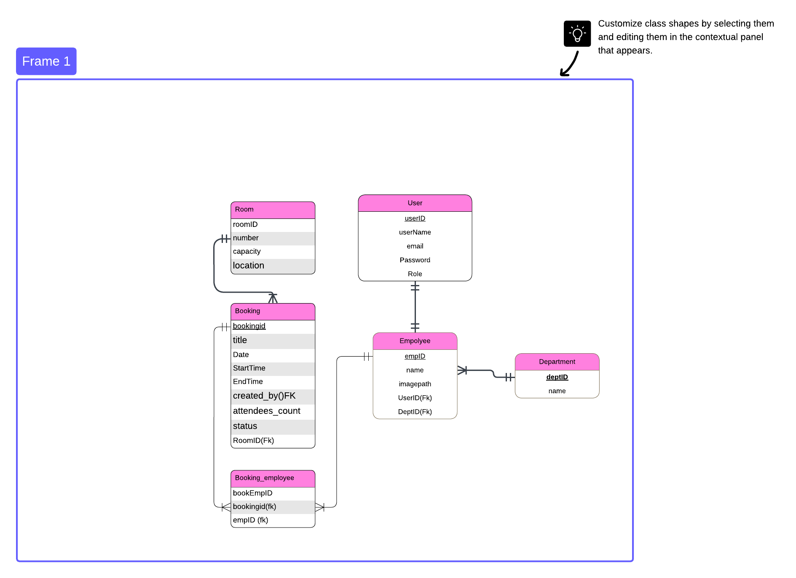

# Meeting Room Booking System

A full-stack meeting room management application built with **PHP, MySQL, HTML, CSS, and JavaScript**. Employees can request meeting rooms, while administrators manage bookings, spaces, people, and access from a centralized dashboard.

## Features

- **Authentication:** registration, sign-in, sign-out, and session-based access.
- **Admin dashboard:** live booking counts, pending requests, upcoming meetings, and room summaries.
- **Full CRUD:** bookings, rooms, employees, departments, user accounts, and attendee assignments.
- **Booking validation:** valid dates and times, room capacity checks, and overlapping booking detection.
- **Booking status:** pending, confirmed, and cancelled.
- **Record management:** search, status filters, pagination, and deletion confirmation.
- **Responsive interface:** compact tables, mobile navigation, and clear status labels.
- **Data protection:** password hashing, prepared SQL statements, CSRF tokens, and escaped output.

## Technology Stack

| Layer | Technology |
| --- | --- |
| Interface | HTML5, CSS3, JavaScript |
| Backend | PHP 8.0+ with object-oriented classes |
| Database access | PDO with the MySQL driver |
| Database | MySQL 8+ or MariaDB 10.4+, using InnoDB |
| Local development | XAMPP / Apache |

## Database Diagram



The diagram illustrates the main entities and their relationships. Use [`database/meeting_room.sql`](database/meeting_room.sql) as the authoritative schema: diagram labels such as `Password` and `Date` correspond to `password_hash` and `bookingDate` in the implementation.

| Table | Purpose |
| --- | --- |
| `users` | Login credentials, email addresses, and roles |
| `employee` | Employee profiles linked to user accounts and departments |
| `department` | Organizational departments |
| `room` | Room numbers, capacities, and locations |
| `booking` | Meeting details, organizer, schedule, room, and status |
| `booking_employee` | Employee assignments to bookings |

A room can have many bookings. An employee belongs to a department and is linked to one user account; a user account may exist before an employee profile is created. The `booking_employee` table connects bookings and employees through a many-to-many relationship.

## Project Structure

| Path | Responsibility |
| --- | --- |
| `app/Admin.php` | Administration queries, CRUD operations, and booking validation |
| `app/Auth.php` | Authentication and registration |
| `app/Database.php` | PDO connection |
| `app/Csrf.php` | CSRF token generation and validation |
| `app/Workspace.php` | Workspace request handling |
| `app/bootstrap.php` | Sessions, shared helpers, and class autoloading |
| `config/database.php` | Database configuration |
| `database/meeting_room.sql` | Fresh-install database schema and sample data |
| `public/` | Web entry points and frontend assets |
| `views/` | PHP/HTML templates |
| `bin/promote-admin.php` | Command-line administrator setup |
| `tests/` | Validation and database integration tests |
| `docs/images/` | Documentation images |

## Run Locally with XAMPP

### 1. Place the project in `htdocs`

Download or clone this repository into:

```text
C:/xampp/htdocs/meeting-room_2
```

Check that the dashboard file is located directly at:

```text
C:/xampp/htdocs/meeting-room_2/public/dashboard.php
```

If extracting a ZIP creates another project folder inside `meeting-room_2`, move its contents up one level.

### 2. Start the services

Start **Apache** and **MySQL** in the XAMPP Control Panel.

### 3. Create and import the database

1. Open [phpMyAdmin](http://localhost/phpmyadmin/).
2. Create a database named `meeting_room`.
3. Select it and import `database/meeting_room.sql`.

Import this SQL file into a fresh database. Existing installations should retain their current data rather than reimport the sample dataset.

### 4. Configure the connection

The local defaults in `config/database.php` are:

| Setting | Default |
| --- | --- |
| Host | `127.0.0.1` |
| Port | `3306` |
| Database | `meeting_room` |
| Username | `root` |
| Password | Empty string |

Update these values to match your installation, or set `DB_HOST`, `DB_PORT`, `DB_NAME`, `DB_USER`, and `DB_PASSWORD` as environment variables. The default application timezone is `Asia/Amman`; override it with `APP_TIMEZONE` if needed.

### 5. Register and sign in

Open:

[http://localhost/meeting-room_2/public/register.php](http://localhost/meeting-room_2/public/register.php)

Create your own account. Sample accounts containing placeholder password hashes do not have a usable demo password.

### 6. Enable administrator access

From Windows Command Prompt, run the following, replacing the email with your registered email:

```bat
cd C:\xampp\htdocs\meeting-room_2
C:\xampp\php\php.exe bin\promote-admin.php your-email@example.com
```

Sign out and sign in again, then open:

[http://localhost/meeting-room_2/public/admin.php](http://localhost/meeting-room_2/public/admin.php)

## Typical Workflow

1. Create departments and user accounts.
2. Link employees to their accounts and departments.
3. Add meeting rooms with their capacities and locations.
4. Submit a booking request with the meeting date, time, and expected attendee count.
5. Review and edit the booking in the admin dashboard.
6. Manage individual attendees in the attendee lists section.

Pending and confirmed bookings reserve their room. Cancelled bookings do not block the time slot. Back-to-back bookings are allowed, but overlapping bookings for the same room are rejected.

## Permissions and Record Relationships

| Action | Employee | Administrator |
| --- | --- | --- |
| View the team workspace | Yes | Yes |
| Request a booking under their own employee profile | Yes | Yes, through the employee workspace |
| Open the admin dashboard | No | Yes |
| Create, edit, or delete managed records | No | Yes |
| Manage user roles | No | Yes |

Administrators cannot delete or demote their own account. Referenced rooms, employees, departments, and users must have their related records reassigned or removed before deletion. Deleting a booking also removes its attendee assignments.

## Validation

Run the schedule validation tests from the project directory:

```bat
C:\xampp\php\php.exe tests\validation.php
```

For integration tests, first create an **empty disposable database** named `gather_test_crud`. Then run:

```bat
set TEST_DB_NAME=gather_test_crud
C:\xampp\php\php.exe tests\integration.php
```

The integration suite imports sample data and exercises CRUD, permissions, password retention, search/filtering, room capacity, overlapping bookings, and relationship protection. It leaves the disposable database available for inspection.

PHP and MySQL execution have not been verified in the source-preparation environment. Run these checks in your local environment before deploying.

## Troubleshooting

| Problem | Check |
| --- | --- |
| `Not Found` | Keep the project inside `C:/xampp/htdocs/` and match the URL to its folder name. |
| Database connection error | Start MySQL, import the schema, and check `config/database.php`. |
| Administrator access denied | Promote your registered account, then sign out and sign in again. |
| Booking rejected | Check the time interval, room capacity, and existing bookings. |
| Record cannot be deleted | Reassign or remove records that reference it first. |

## Deployment

For deployment, configure the web server document root to `public/`. Keep application code, database scripts, configuration, command-line utilities, and tests outside the public document root. Configure server credentials through environment variables and use HTTPS.
